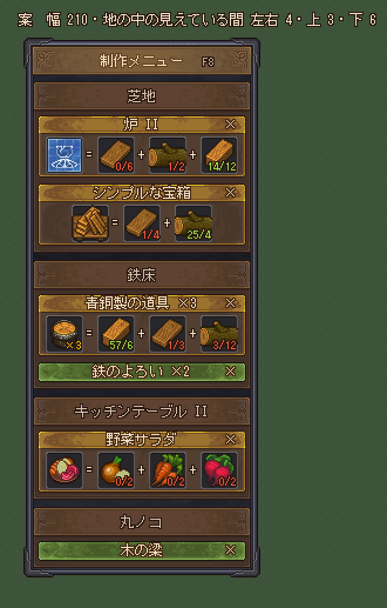

# Craft Todo（製作メモ）

レシピを、画面の左（顔とエネルギーの枠の下）に「制作メニュー」として残す BepInEx プラグイン。
**マウスのホイールを押し込むと、その下のレシピを登録できる**（作れるものも作れないものも）。押すたびに回数が増える。
チェストまで素材を取りに行く間に、何をいくつ持って戻ればいいかを忘れないためのもの。



- 板の中の上の木の帯に「制作メニュー」。その下に**制作機ごとの区切り**（所持品の窓と同じ見出し板に制作機の名前）と、
  その下の茶色の地（所持品の窓のセルの下の地）。地の中に**料理ごとの札**（技術ツリーの札の足を外したもの）を左右 4・上 3・下 6 空けて並べる（見えている間。上は見出し板の下端から、左右と下は地の端から）。
  札の名札に「料理 ×回数」と ×、中に「[作る物] = [素材] + [素材] …」のセル。作る物のセルの右下は回数（2 回以上のとき）、
  素材のセルの右下は「使える数/要る数」（足りれば緑、足りなければ赤）
- 素材が全部そろった料理は、緑の名札の帯だけになって（セルは出さない）その制作機の一番下へ回る。制作機の料理が全部そろうと、
  その制作機が一番下へ回る（制作機の名前の色は変えない）
- **札を左クリックすると、セルの段を出し入れできる**（そろった料理も、そろっていない料理も。× は外す）。押した状態は
  並べ直しても残り、その料理がそろった / そろわなくなったときと、ゲームを閉じたときに既定（そろったら畳む）へ戻る。
  ⚠ 札の上ではゲームの左クリック（攻撃など）が効かない（ゲームは UI の上のクリックを止める）
- **セルにマウスを乗せると、ゲームのツールチップが出る**（0.6.0〜。ゲームパッドのときは出ない。下の「セルのツールチップ」）
- 板の幅は 210 に固定。料理や制作機の名前が入りきらないときは末尾を「…」で省略する
- 制作機の順と、制作機の中の料理の順は、メモの一覧の順（新しく足したものが上）。同じ種類の制作機でも、置いてある台が違えば別の区切り
- 板は左上の HUD（日の輪）と「？」ボタンの下から、画面の下端までに収まる。入りきらない件は、板の上でマウスのホイールを回すと
  スクロールする（所持品の窓と同じくスクロールバーは無く、下に続きがあると中身の下端が少し暗くなる）

## 使い方

| したいこと | 操作 |
| --- | --- |
| メモに足す | レシピの上で**ホイールを押し込む**（下の表の場所で効く）。**押すたびに回数が増える**（3 回押せば ×3） |
| 回数を減らす | 同じ場所で**左 Shift ＋ ホイールの押し込み**。0 になったらメモから消える |
| メモから外す | 札の名札の右の × を押す（回数に関わらず 1 件まるごと。制作機の区切りには × は無い） |
| セルの段を出す・畳む | 札の × 以外のところを左クリック（セルの上でもよい） |
| 作る物・素材の説明を見る | セルにマウスを乗せる |
| 何回分かをまとめて足す | 回数を選ぶ窓で回数を選んでから、窓の上でホイールを押し込む（選んでいる回数分が増える） |

| ホイールを押し込む場所 | 1 回押すと増える数 |
| --- | --- |
| 建築机の窓（スクショの「工場」の窓など）の行・その素材のセル | その建物・拡張を 1 つ |
| 作業台の窓のレシピのアイコン | そのレシピを 1 回分（まだ覚えていない「？」のレシピは登録できない） |
| 作業台のキューの行 | そのレシピを、キューの回数分 |
| 回数を選ぶ窓（「作る」「キューに追加する」の窓）のどこか | そのレシピを、選んでいる回数分 |

⚠ ほかのキー（移動の WASD など）を押したままだとホイールは効かない（BepInEx のショートカットの決まり）。

| ほかの操作 | キー |
| --- | --- |
| 全部消す | Ctrl+F8 |
| 隠す・出す | F8 |

- 素材の数は「**作る場所に戻ったときに使える数**」＝ 持ち物 ＋ 作る場所と同じゾーンの収納（ゲームの作業台が素材を探す範囲と同じ）。
  別の場所のチェストから持ち物に移すと数が増え、足りたら緑になる。全部そろうと札が緑の名札の帯だけになり、その制作機の一番下へ回る
- 「どの種類でもよい」素材（グループ）は、そのグループのどれでも数える（セルのアイコンはグループの最初の品）
- 要る数は回数分（×3 なら 3 回分）。耐久を使う道具は何回分でも 1 本
- 実際に作ると、作った回数だけ減り、0 になると消える。製作は**作業台が 1 回分を作り始めるたびに 1 つ**（素材が引かれたとき。
  「作る」でも「キューに追加する」でも、キューの続きでもゾンビの作業でも同じ。キューに入れただけで、素材を待っている間は減らない）。
  建物は設置を確定したときに 1 つずつ（設置の画面に入ってやめても減らない。拡張などその場で建つものは行を押したとき）
- 同じレシピを足すと、同じメモの回数が増える（並びは動かない）。同じレシピでも作る場所が違えば別のメモ
- メモはセーブ枠ごとに `BepInEx/config/CraftTodo/todo-<枠>.txt` に残る（ゲームを閉じても消えない）。
  0.2.0 までの形式（v1）もそのまま読める（回数 1 として読む）
- 見た目はゲームの絵をそのまま使う: 本体の板は建物の窓（角飾りの枠と石板の地）、制作機の区切りと茶色の地は所持品の窓の見出し板と地、
  料理ごとの札・その中の 32 のセル・名札の文字・アイコンの縁の色は技術ツリーの札、上の帯は人物の窓の中の所持品の窓と同じ形
  （枠の中に木の帯と両端の飾り）、スクロールの下端の影は所持品の窓のもの。どれも等倍（ドット絵がにじまないよう、スクロールの位置も
  含めて整数の位置に置く）。引けなかった部品はその部品だけ単色になる。札そのものが引けないときは 0.4.4 の形（1 件ごとに見出し板
  「制作物 ×回数・制作機」と茶色の地、そろった件は見出し板だけに畳む）に戻る
- 技術ツリーの札の絵は 126x64 の 1 枚で、下に足（技術点の値段の欄）がある。足を外し（上の 51 行の下に、いちばん下の 3 行を継ぐ → 高さ 54）、
  横は中央の 62 列を 1 回おきに左右反転して繰り返して広げる。そろった料理は緑の札の名札の帯（上の 15 行）にいちばん下の 3 行を継ぐ（高さ 18）。
  札の幅は全部同じ（板 210 から枠の内側 12・地の左右 4 を引いた 178）
- 茶色の地の絵は 178x48 で縁が上下 20 あるが、縁らしい行は上 1 行・下 4 行だけ（間は同じ行の繰り返し）。縁を細くした写しを作って、
  札 1 枚だけの低い地でも縁が潰れないようにする（作れなければ地を 40 より低くしない）。上の木の帯の絵（228x26、縁 左右 96）も
  列 94〜133 が同じ列なので、縁を 94 にした写しで幅 188（板 210 の内側）まで縮める
- 名札の文字は技術ツリーの札と同じ小さな書体（`tiny_font-tech_palte_opened` / `-available`）。アイコンの縁の色も技術ツリーのセルと同じ（1F1F28）。
  文字の枠はゲームと同じ高さ 16・上下中央だが、ゲームと同じ上端 0 に置くと日本語の文字（縁取り込みで 12 行）が帯（行 1〜14）の
  上 0・下 2 に出るので、1 下げて上 1・下 1 にしている（× も同じ）
- 石板の地の絵は 406 の高さしかない。板がそれより高いときは、絵の上下のベタの行を削って上下反転しながら継ぐ（0.4.1 までは
  そのまま敷き詰めていたので、継ぎ目に模様の無い帯が出た）
- 幅は 210 に固定（本人の指定）。材料はゲームの定義で最大 3 種（起動時にログの `レシピの素材のセルの数` の行に分布が出る）で、
  作る物＋素材 3 つのセルの段は札に入る。それでもセルの段か上の帯が入らないときだけ広げ、ログの `制作メニューの幅` の行に
  どれで決まったかが出る。0.4.0 のスクショの 5 件で、0.4.4 は幅 278 だった（UI の単位）

### セルのツールチップ（0.6.0〜）

窓はゲームのツールチップそのもの（中身の並べ方もゲームと同じ部品）。中身はセルで変わる（本人と図で決めた形）:

| セル | 出るもの |
| --- | --- |
| 作る物 | 所持品のアイテムと同じ説明（名前・説明・効果・作成場所）。建物は名前と説明 |
| 素材（作り方があるもの） | 制作の窓のレシピと同じ形: 「レシピ名＋技能のアイコン＋要るレベル」・効果・**作成場所**・要る拡張・素材の並び（持っている数/要る数） |
| 素材（採るだけのもの） | 所持品のアイテムと同じ説明 |

- 要るレベルに届いていなければ数字が赤、スター制作は金の「1-N」（ゲームと同じ）
- 素材の並びの「持っている数」は札と同じ数え方（持ち物＋その札の制作機のゾーンの収納）
- 作り方が何通りもある素材は、**置いてある制作機で作れるレシピ**を出し（無ければゲームの順で最初のもの）、最後に
  「ほかの作り方: あと N 通り」。作り方はゲームの「作成場所」と同じ選び方で集める（起動時にログの `作り方の索引` の行に数が出る）
- 「どの種類でもよい」素材は、セルのアイコンに出している品（グループの最初の品）で決める
- ゲームの部品が引けなかったときはログに `ゲームのツールチップの部品が引けない` が出て、ツールチップだけ出なくなる（メニューはそのまま）

## 設定

`<ゲーム>/BepInEx/config/tanmen.gk2.crafttodo.cfg`（初回の起動で作られる）。

| 項目 | 既定 | 中身 |
| --- | --- | --- |
| `Display.ToggleKey` | `F8` | 表示・非表示 |
| `Display.ClearKey` | `F8 + LeftControl` | 全部消す |
| `Display.MaxEntries` | `8` | 残す数の上限（古いものから消える） |
| `Display.GameFrame` | `true` | 板・区切り・札・セルをゲームの絵にする。`false` なら 0.4.4 の並び（1 件ごとに見出し板と地）を単色で描く（帯は出さず、見出しを板の中に書く） |
| `Position.AutoPosition` | `true` | 左上の HUD の枠と「？」ボタンのすぐ下に置く（「？」は窓を開いている間などに消えるが、板が上下しないよう場所は空けたまま）。`false` なら画面の上から 17% の高さ |
| `Position.OffsetX` / `OffsetY` | `4` / `4` | 置き場所からのずらし（UI の単位。右・下が正）。縦は、上の部品と板の枠の**見えている端どうしの間**（「？」の下の影と枠の絵の上の透明な 4 行は数えない） |
| `Adding.RegisterKey` | `Mouse2`（ホイールの押し込み） | マウスの下のレシピの回数を足すキー。キーボードのキーにもできる（例: `R`） |
| `Adding.RemoveKey` | `Mouse2 + LeftShift` | マウスの下のレシピの回数を減らすキー |
| `Adding.AddOnBlockedClick` | `false` | `true` にすると、素材の足りない建物の行・灰色の「作る」を左クリックしたときにも足す（ゲームパッドの「作る」キーも。ホイールの無い操作のため。何度押しても回数は増え続けない） |
| `Adding.AddWhenCraftWindowOpens` | `false` | `true` にすると、作業台でレシピを開いた時点で作れなければメモに足す |

## ビルドと手元での導入

1. `Game.local.props.example` を写して `Game.local.props` を作り、`GameDir` をゲームの導入先にする（gitignore 済み）
2. ビルドしてセーブデータの `Mods/Code/CraftTodo/` に置く:

   ```powershell
   dotnet build CraftTodo/CraftTodo/CraftTodo.csproj -c Release -p:DeployToGame=true
   ```

   ⚠ Claude デスクトップの中から動かすときは `AppData\LocalLow` が仮想化されてゲームから見えないので、
   `-p:ModsCodePath=\\localhost\C$\Users\<ユーザー>\AppData\LocalLow\Lazy Bear Games\Graveyard Keeper 2\Mods\Code` を足す
3. ゲームを起動し直す。`<ゲーム>/BepInEx/LogOutput.log` に `Loading [Craft Todo <版>]` と
   `パッチ: 成功 6 / 失敗 0` が出れば入っている（失敗が出たら、ゲームの更新で差し込み先の形が変わった。0.4.1 までは 7）

止めたいときは、ゲームのメインメニューの Mods の窓で無効にするか、`Mods/Code/CraftTodo` を `~CraftTodo` に改名する。

版は `CraftTodo/CraftTodo.csproj` の `Version` の 1 か所だけに書く（プラグインの属性と `modinfo.json` はそこから作る）。

## 作り

| ファイル | 中身 |
| --- | --- |
| `CraftTodo.Core/` | メモの一覧（回数の足し引き・上限）・保存形式・足りる / 足りないの判定。ゲームに依存しないのでテストできる |
| `CraftTodo/TodoPicker.cs` | 登録キーを押したとき、マウスの下の部品からレシピを引く（ゲームの UI のレイキャスト） |
| `CraftTodo/Patches.cs` | ゲームに差し込む所（Harmony）。建物の行の押下・建物の設置・灰色の「作る」・作業台が 1 回分を作り始めたとき |
| `CraftTodo/GameBridge.cs` | ゲームの型との境目（メモの組み立て・名前とアイコン・在庫の数え方） |
| `CraftTodo/TodoOverlay.cs` | 画面の制作メニュー（ゲームの UI の根の下に自分の Canvas を置き、部品を整数の位置に並べる。画面の下端で抑えてスクロール。札が引けないときの 0.4.4 の形） |
| `CraftTodo/TodoOverlay.Plates.cs` | 0.5.x の形: 制作機ごとの区切りと茶色の地、料理ごとの札（札の絵の切れ端を並べて横に広げる。そろった料理を名札の帯だけにして下へ回す。名前の省略） |
| `CraftTodo/ScrollArea.cs` | 何も描かずにホイールだけ受け取る面（中身があふれたときだけ当たる） |
| `CraftTodo/ClickArea.cs` | 何も描かずに左クリックだけ受け取る面（札を押してセルの段を出し入れする） |
| `CraftTodo/TooltipBridge.cs` | セルのツールチップの中身を組んでゲームの `UITooltip` に渡す（ゲームの private の組み立てと文字の形を反射で引く・作り方の索引） |
| `CraftTodo/CellTooltip.cs` | セルに乗った / 離れたでツールチップを出す・消す（セルの左クリックは札の出し入れへ回す） |
| `CraftTodo/MenuParts.cs` | 帯・見出し板・茶色の地・セル・スクロールの影・アイコンの材質を、所持品の窓と SpriteAtlas から写す |
| `CraftTodo/PlateParts.cs` | 料理ごとの札（金・緑）・札のセル・名札の文字の形・アイコンの材質を、技術ツリーの札から写す（足を外す範囲を切った sprite を作る） |
| `CraftTodo/LabelStyler.cs` | 文字を所持品の窓の見出し・セルの数と同じ書体にする（言語ごとの書体を TextStyle が選ぶ） |
| `CraftTodo/PanelSkin.cs` | 本体の板の枠と地をゲームの建物の窓から写す（地が足りない高さは反転して継ぐ） |
| `CraftTodo/UiFactory.cs` | uGUI の部品を組む小道具（左上からの位置で置く・縁のある絵は Sliced・絵の画素数どおりの大きさ） |
| `CraftTodo/UiDiagnostics.cs` | 枠を写せなかったとき、ゲームの UI の枠らしい Image をログに並べる（見た目を合わせ直す手がかり） |

差し込み先を決めた根拠（ゲームのどのクラスのどこか）は [docs/game-api-notes.md](docs/game-api-notes.md)。
