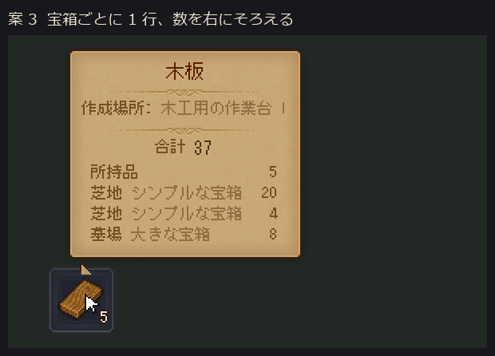

# Stock Finder（在庫の在りか）

アイテムのツールチップの一番下に、**その品がどこの宝箱に何個あるか**と、**所持品と宝箱を合わせた合計**を足す BepInEx プラグイン。
宝箱を 1 つずつ開けて探さなくても、ツールチップを見ればどこへ取りに行けばいいかが分かる。



表は 1 行ずつ別の文字の部品にしている（0.1.1〜。0.1.0 は 1 つの部品に改行で詰めていて、小さい書体の行送りが字の高さより狭く、行が重なった）。

- ゲームの説明・効果・作成場所などの行はそのまま残し、その下に区切りを入れて足す
- 「合計 N」は所持品（袋の中も）と、世界にある宝箱の全部を足した数
- その下に**宝箱ごとに 1 行**で「場所  宝箱 … 数」。宝箱の名前の列と数の列（右揃え）をそろえる。
  先頭は所持品の行。そのあと場所ごと（場所の合計の多い順）に、場所の中は数の多い順
- 同じ場所に同じ種類の宝箱が 2 つ以上あっても、まとめずに 1 つずつの行にする（名前は同じなので、どちらかは開けて確かめる）
- 数が 0 の所は出さない。どこにも無ければ「合計 0」だけ
- 行が多いとき（既定は 8 行を超えたとき）は、残りを「ほか N か所 … 数」の 1 行にまとめる

## どのツールチップに出るか

ゲームが品の説明を出すツールチップの全部（ゲームの同じ組み立てに足すので、どこでも同じ形）:

| 場所 | 何の数 |
| --- | --- |
| 所持品・宝箱の窓のセル | そのアイテム |
| 制作の窓のレシピ・キュー | 出来上がる品 |
| 制作の窓の素材のセル・出来上がりのセル | そのアイテム |
| 技術ツリーのセル | そのアイテム |
| 注文・商人の窓のアイテム | そのアイテム |
| Craft Todo（制作メニュー）のセル | 作る物・素材（作り方の出る素材は、その素材） |

ゲームパッドでも、ゲームがツールチップを出す所なら同じく出る（ゲームパッドでは確かめていない）。

## 数える範囲

- **宝箱** = ゲームが所持品の窓でまとめて開く収納（シンプルな宝箱・大きな宝箱・道具棚・物資保管庫・庭の保管スペースなど。
  ゲームの定義で `open_in_multi_inventory` のもの）。作業台・かまどなどの制作機の中の物は数えない
- 場所の名前は右上の地名の枠と同じ。どの場所にも入っていない宝箱は「ほかの場所」
- 別の物の在庫を指す物（同じ中身を 2 か所から開ける物）は、同じ在庫を 1 度だけ数える
- 品はアイテムの種類（id）で数える。品質（星）の違う品は別の品

## 設定（`BepInEx/config/tanmen.gk2.stockfinder.cfg`）

| 設定 | 既定 | 中身 |
| --- | --- | --- |
| `Display.Enabled` | `true` | ツールチップに在庫を足す |
| `Display.MaxRows` | `8` | 場所の行の上限（所持品と「ほか N か所」の行も含む。1〜30） |
| `Display.Layout` | `Table` | `Table`: 列にそろえる / `Lines`: 1 行ずつ「場所 宝箱: 数」を中央揃え（列がずれるときの逃げ道） |

## 確かめ方（`<ゲーム>/BepInEx/LogOutput.log`）

| 行 | 分かること |
| --- | --- |
| `Loading [Stock Finder 0.1.1]` | 読み込まれた |
| `パッチ: 成功 3 / 失敗 0` | 差し込みが全部当たった |
| `ゲームのツールチップの部品を引いた（文字の形 3）` | ゲームのツールチップの文字の形が引けた（初めてツールチップを出したとき） |
| `宝箱を拾った: N 個（場所 M か所…）` | 数える宝箱の数（初めてのとき。0 個なら警告になる） |
| `ツールチップに在庫を初めて足した: <id> 合計 N…` | 初めて足したときの品と並べ方 |
| `表の行の幅: こちらの測り方 X・ツールチップの文字の部品 A / B / …` | 2 行以上の表を初めて出したとき、行ごとの部品の幅がこちらの測り方と同じで、全部の行でそろっているか（ずれると警告） |

⚠ BepInEx の `LogOutput.log` は、ゲームが動いている間は書き出しが溜まって数行しか無いことがある。前の起動の分は、セーブデータの
`Player-prev.log`（Unity のログ）にも同じ行が全部ある。

## ビルド・配置

```bash
dotnet test StockFinder/StockFinder.Core.Tests
dotnet build StockFinder/StockFinder -p:DeployToGame=true
```

mod 本体のビルドにはゲームの導入先が要る（`Game.local.props.example` を写して `Game.local.props` を作るか、`-p:GameDir=...`）。
置き場と ⚠ は [docs/modding.md](../docs/modding.md)。調べたゲームの中身は [docs/game-api-notes.md](docs/game-api-notes.md)。
